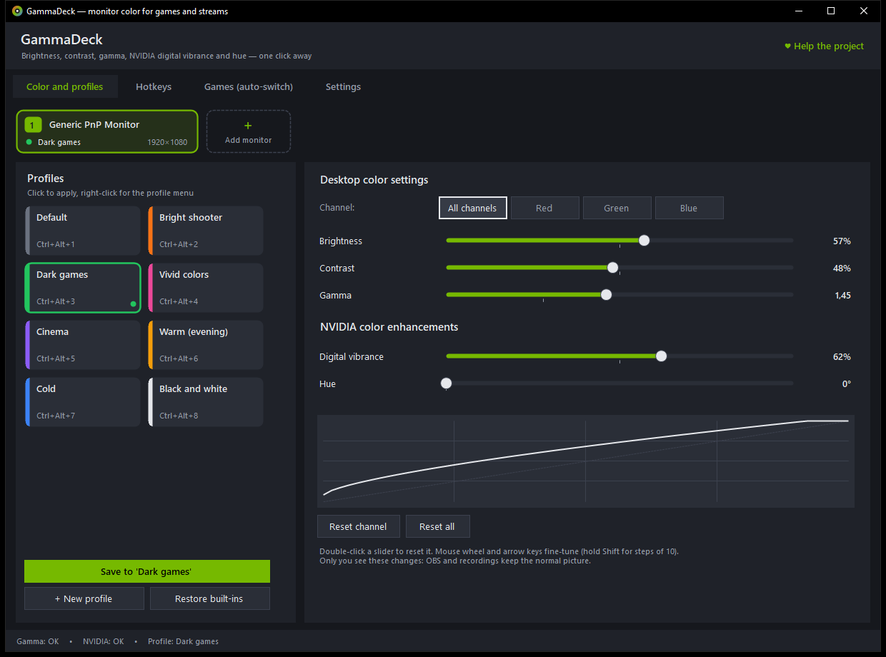
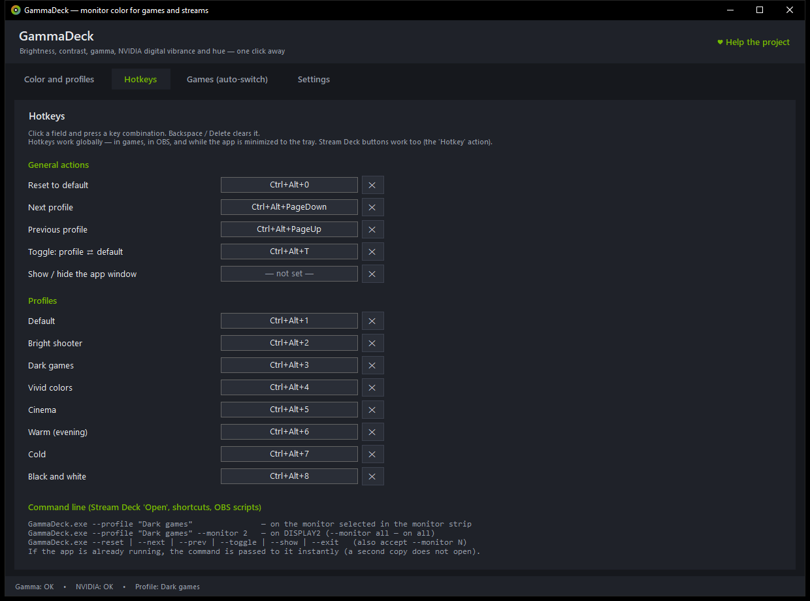
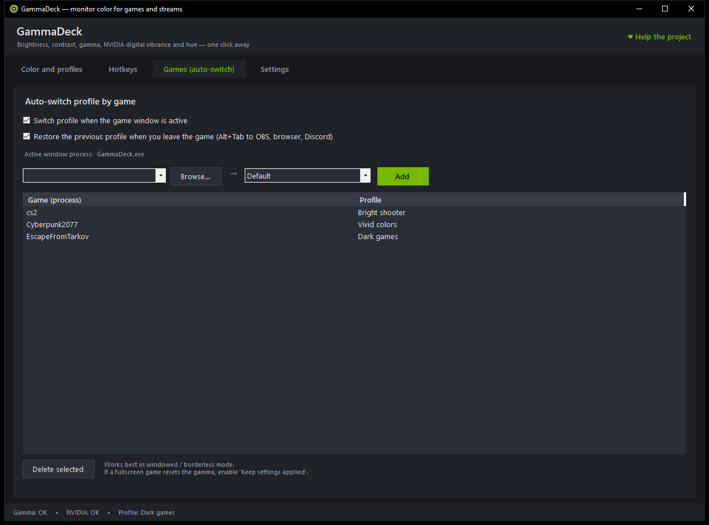
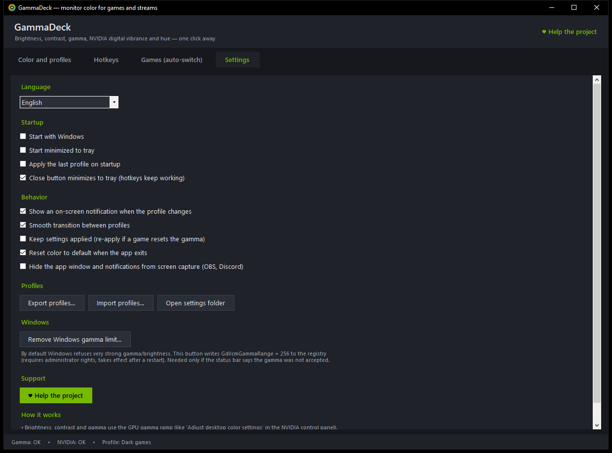

<p align="center">
  <a href="https://dalink.to/olegche"></a>
</p>

# GammaDeck

[Русский](README.md) · **English**

[](../../releases/latest)
[](../../releases)
[](#install)
[](LICENSE)

A small utility for Windows with an NVIDIA GPU: **monitor color like "Adjust desktop color settings" in the NVIDIA Control Panel, but one click or one hotkey away**. Brightness, contrast, gamma, digital vibrance and hue are saved as profiles; a profile switches on with a button, a hotkey, a Stream Deck key, or automatically when the right game starts.

Made for streamers: only you see the changes. OBS, Discord and recordings keep the normal picture.



**[⬇ Download the latest version (zip)](https://github.com/OlegChe77/gammadeck/releases/latest/download/GammaDeck.zip)** (`GammaDeck.zip`, a single `GammaDeck.exe` inside, about 60 KB)

Nothing to install: unzip and run. Needs Windows 10 or 11 (.NET Framework 4.8 is already included) and an NVIDIA driver.

## Features

- **Everything from "Adjust desktop color settings" in the NVIDIA Control Panel:** brightness, contrast, gamma (all channels at once or red / green / blue separately), digital vibrance and hue.
- **Profile buttons.** As many as you like, each with its own color; rename, duplicate, reorder. Eight built-in: Default, Bright shooter, Dark games, Vivid colors, Cinema, Warm (evening), Cold, Black and white.
- **Global hotkeys:** one per profile, plus reset, next / previous profile, "profile ⇄ default" and show window. They work in games, in OBS and while the window is minimized to the tray.
- **Auto-switch by game.** Game window active → its profile on the monitor where the window is; Alt+Tab to OBS or a browser → the previous profile comes back.
- **Different profiles on different monitors** at the same time: e.g. "Dark games" on the gaming monitor, "Default" on the OBS monitor. The monitor strip on top shows each monitor's profile; the **+** card re-detects connected monitors.
- **Per-monitor profile hotkey:** right-click a profile → "Hotkey for a specific monitor".
- Smooth transitions, on-screen notification, tray menu (a submenu per monitor), autostart with Windows.
- **The window and notifications are hidden from capture** (OBS, Discord): viewers don't see them.
- Export / import profiles (JSON) to share them with friends.
- **English and Russian** interface (Settings → Language). It follows the Windows display language by default and switches instantly.
- On the very first launch a "GammaDeck" shortcut appears on the desktop (once only: delete it and it will not come back).

|  |  |
|:--|:--|
| Hotkeys | Auto-switch by game |



## Install

1. Download **[GammaDeck.zip](https://github.com/OlegChe77/gammadeck/releases/latest/download/GammaDeck.zip)** (always the latest version).
2. Unzip it to any folder, for example `Documents`.
3. Run `GammaDeck.exe`.

If Windows shows the blue SmartScreen window ("Windows protected your PC"): the app is not signed with a digital certificate. Click "More info" → "Run anyway". The source code is open, so you can build it yourself (see below).

To uninstall: exit the app (tray icon → right-click → Exit) and delete the folder and the shortcut. Settings live in `%APPDATA%\GammaDeck`.

## Stream Deck / command line

```
GammaDeck.exe --profile "Dark games"              (on the monitor selected in the monitor strip)
GammaDeck.exe --profile "Dark games" --monitor 2  (on \\.\DISPLAY2; --monitor all = all monitors)
GammaDeck.exe --reset | --next | --prev | --toggle | --show | --exit   (also accept --monitor N)
GammaDeck.exe --diag      (monitor and driver report in %APPDATA%\GammaDeck\diag.txt)
```

In Stream Deck use the "Hotkey" action or "Open" with the parameters above. Built-in profile names are English in commands; the Russian names (e.g. `--profile "Тёмные игры"`) are accepted too.

## If the gamma "does not apply"

- Windows limits very strong values. Settings → "Remove Windows gamma limit…" (needs administrator, then restart).
- In exclusive fullscreen some games reset the gamma: "Keep settings applied" or borderless windowed mode helps.

## How it works

- Brightness, contrast and gamma use the GPU gamma ramp (like the NVIDIA Control Panel does).
- Digital vibrance and hue go straight through the NVIDIA driver (NVAPI).
- All of it is applied at the GPU output, so stream viewers and recordings see the normal picture; only your screen changes.

## Build from source

You only need the C# compiler from .NET Framework 4.x, which is already part of Windows. The code is C# 5 and the UI is plain WinForms built in code.

```
build.bat          →  bin\GammaDeck.exe
```

Check without changing any color: `bin\GammaDeck.exe --diag`.

## Support the project

If the app is useful to you, you can support the author here: **https://dalink.to/olegche**. It is the same as the "Help the project" button inside the app.

## License

[MIT](LICENSE)
