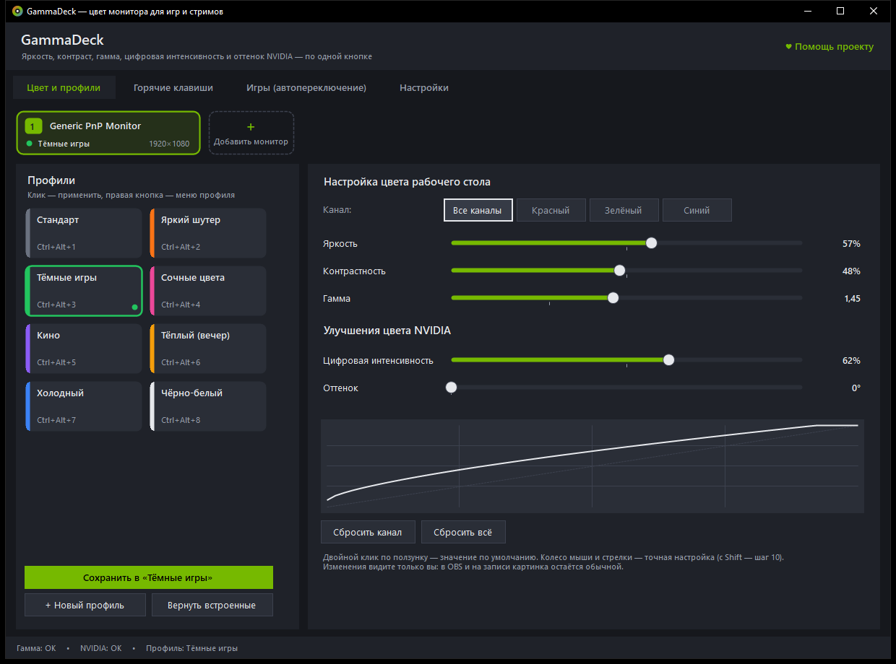
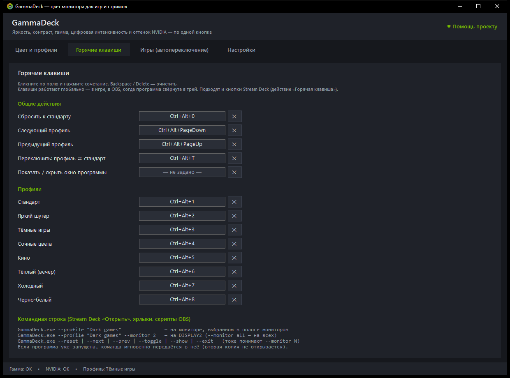
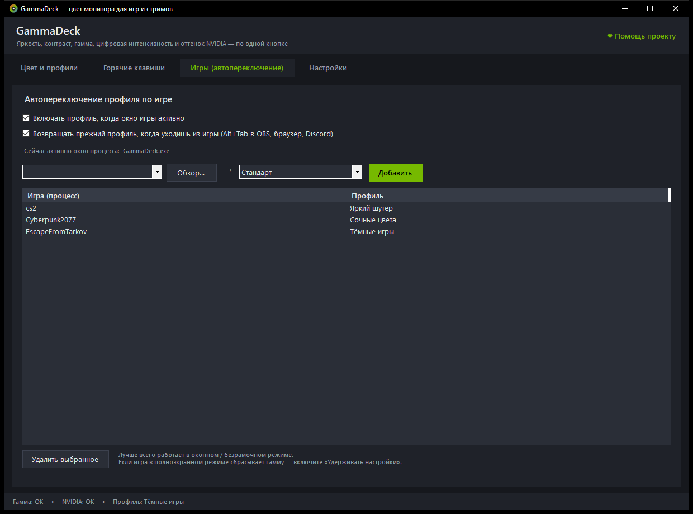
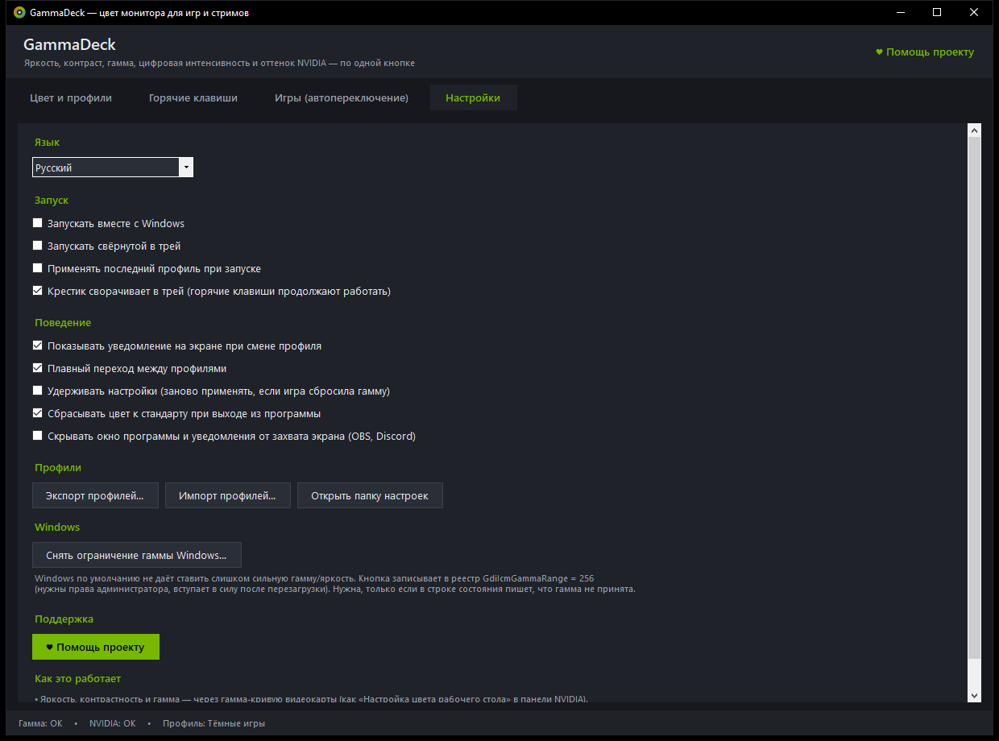

<p align="center">
  <a href="https://dalink.to/olegche"></a>
</p>

# GammaDeck

**Русский** · [English](README.en.md)

[](../../releases/latest)
[](../../releases)
[](#установка)
[](LICENSE)

Маленькая утилита для Windows с видеокартой NVIDIA: **цвет монитора как в «Настройке цвета рабочего стола» панели NVIDIA, но в один клик и на горячих клавишах**. Яркость, контраст, гамма, цифровая интенсивность и оттенок собираются в профили; профиль включается кнопкой, сочетанием клавиш, кнопкой Stream Deck или сам, когда запускается нужная игра.

Главное для стримеров: изменения видите только вы. В OBS, Discord и в записи картинка остаётся обычной.



**[⬇ Скачать последнюю версию (zip)](https://github.com/OlegChe77/gammadeck/releases/latest/download/GammaDeck.zip)** (`GammaDeck.zip`, внутри один файл `GammaDeck.exe`, около 60 КБ)

Ставить ничего не нужно: распакуйте и запустите. Нужны Windows 10 или 11 (в них уже есть .NET Framework 4.8) и драйвер NVIDIA.

## Возможности

- **Всё из «Настройки цвета рабочего стола» NVIDIA:** яркость, контрастность, гамма (сразу по всем каналам или отдельно красный, зелёный, синий), цифровая интенсивность и оттенок.
- **Профили-кнопки.** Сколько угодно своих, у каждого свой цвет; переименование, дубликат, перестановка. Восемь готовых: «Стандарт», «Яркий шутер», «Тёмные игры», «Сочные цвета», «Кино», «Тёплый (вечер)», «Холодный», «Чёрно-белый».
- **Глобальные горячие клавиши:** по одной на каждый профиль, плюс сброс, следующий и предыдущий профиль, «профиль ⇄ стандарт», показать окно. Работают в играх, в OBS и когда окно свёрнуто в трей.
- **Автопереключение по игре.** Окно игры активно, включается её профиль на том мониторе, где оно открыто; Alt+Tab в OBS или браузер, возвращается прежний профиль.
- **Разные профили на разных мониторах** одновременно: например, «Тёмные игры» на игровом, «Стандарт» на мониторе с OBS. Полоса мониторов сверху показывает профиль каждого; карточка **+** заново ищет подключённые мониторы.
- **Горячая клавиша профиля для конкретного монитора:** правая кнопка по профилю → «Горячая клавиша для конкретного монитора».
- Плавный переход между профилями, уведомление на экране, меню в трее (подменю по мониторам), запуск вместе с Windows.
- **Окно и уведомления скрыты от захвата** (OBS, Discord): зрители их не видят.
- Экспорт и импорт профилей (JSON): можно делиться с друзьями.
- Интерфейс на **русском и английском** (Настройки → Язык). По умолчанию берётся язык Windows, переключение мгновенное.
- При самом первом запуске создаётся ярлык «GammaDeck» на рабочем столе (один раз: удалите его, и он не вернётся).

|  |  |
|:--|:--|
| Горячие клавиши | Автопереключение по игре |



## Установка

1. Скачайте **[GammaDeck.zip](https://github.com/OlegChe77/gammadeck/releases/latest/download/GammaDeck.zip)** (всегда последняя версия).
2. Распакуйте в любую папку, например в `Документы`.
3. Запустите `GammaDeck.exe`.

Если Windows показала синее окно SmartScreen («Windows защитила ваш компьютер»): программа не подписана цифровой подписью. Нажмите «Подробнее» → «Выполнить в любом случае». Исходный код открыт, можно собрать самому (см. ниже).

Удаление: закройте программу (в трее правая кнопка → «Выход») и удалите папку и ярлык. Настройки лежат в `%APPDATA%\GammaDeck`.

## Управление из командной строки и Stream Deck

```
GammaDeck.exe --profile "Dark games"              (на мониторе, выбранном в полосе мониторов)
GammaDeck.exe --profile "Dark games" --monitor 2  (на \\.\DISPLAY2; --monitor all — на всех)
GammaDeck.exe --reset | --next | --prev | --toggle | --show | --exit   (тоже принимают --monitor N)
GammaDeck.exe --diag      (отчёт о мониторах и драйвере в %APPDATA%\GammaDeck\diag.txt)
```

В Stream Deck используйте действие «Горячая клавиша» или «Открыть» с этими параметрами. Названия встроенных профилей в командах английские, русские (`--profile "Тёмные игры"`) тоже принимаются.

## Если гамма «не применяется»

- Windows ограничивает слишком сильные значения. Настройки → «Снять ограничение гаммы Windows…» (нужны права администратора, затем перезагрузка).
- В полноэкранном эксклюзивном режиме некоторые игры сбрасывают гамму: помогает «Удерживать настройки» или оконный режим без рамки.

## Как это работает

- Яркость, контрастность и гамма идут через гамма-кривую видеокарты (как в панели NVIDIA).
- Цифровая интенсивность и оттенок идут напрямую через драйвер NVIDIA (NVAPI).
- Всё применяется на выходе видеокарты, поэтому в OBS и в записи картинка обычная, меняется только ваш экран.

## Сборка из исходников

Нужен только компилятор C# из .NET Framework 4.x, он уже есть в Windows. Язык исходников: C# 5, интерфейс на WinForms без дизайнера.

```
build.bat          →  bin\GammaDeck.exe
```

Проверка без смены цвета: `bin\GammaDeck.exe --diag`.

## Помощь проекту

Если программа пригодилась, поддержать автора можно здесь: **https://dalink.to/olegche**. Это же — кнопка «Помощь проекту» в самой программе.

## Лицензия

[MIT](LICENSE)
